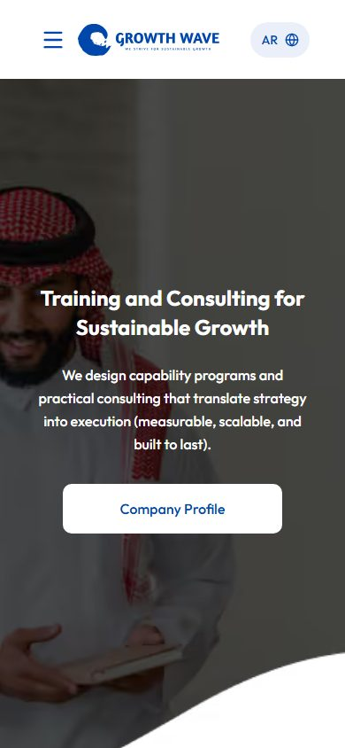
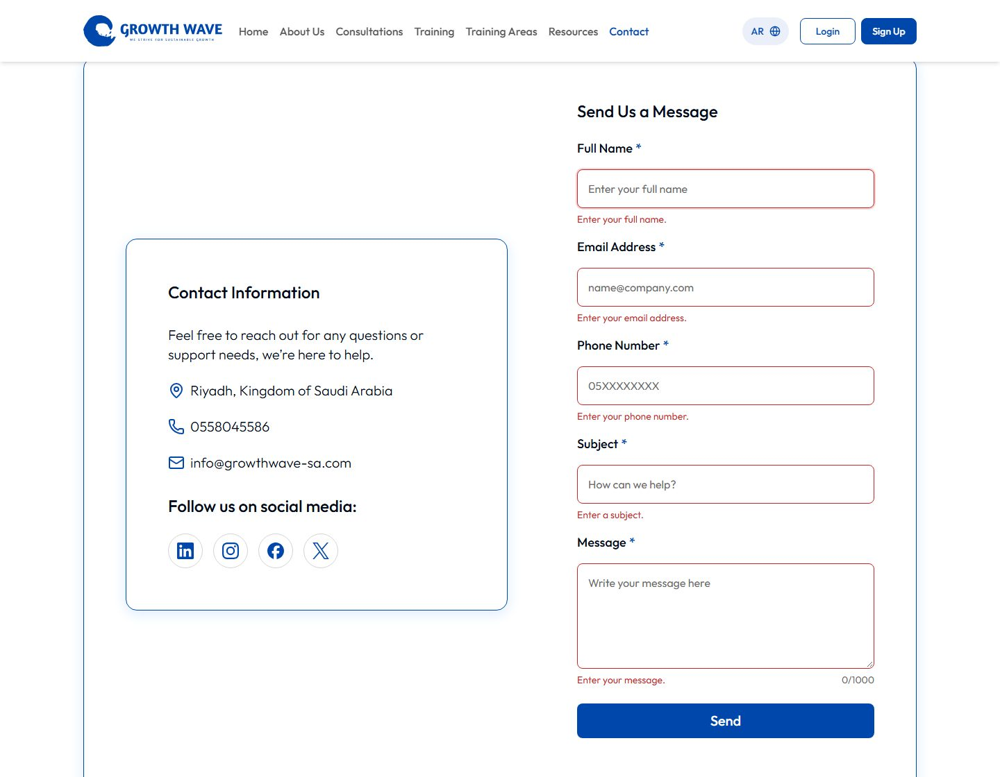

# Growth Wave — Home & Contact

**Live preview:** _added here once the Vercel project is connected._

The Home and Contact Us pages of [Growth Wave](https://growthwave-sa.com), a Saudi training and consulting company, rebuilt in Next.js. Both pages come in Arabic (right to left, the default) and English (left to right), and follow Growth Wave's own identity: its logo, photos, partner logos and brand blue.

| Arabic home, desktop                                      | English home, phone                                                  |
| --------------------------------------------------------- | -------------------------------------------------------------------- |
|  |  |



- **Home:** hero with the company profile PDF, about, services, the six most requested courses, partners and a call to action.
- **Contact Us:** a validated form (full name, email, Saudi mobile number, subject, message), the contact details and a Google Maps embed.
- **Every other link works:** the remaining nav pages, Login and Sign Up open a localized "Coming soon" page; any other URL gets a localized 404.

## Tech stack

| Tool                                                    | Why                                                                                                                                            |
| ------------------------------------------------------- | ---------------------------------------------------------------------------------------------------------------------------------------------- |
| [Next.js 16](https://nextjs.org) (App Router)           | Every page is prerendered at build time, so it is served as static HTML.                                                                       |
| React 19, TypeScript (strict)                           | Type errors are caught before they reach the page.                                                                                             |
| [Tailwind CSS 4](https://tailwindcss.com)               | Brand colors live as `@theme` tokens, and logical utilities (`ms-*`, `ps-*`, `start-*`) let one set of styles serve RTL and LTR.               |
| [next-intl 4](https://next-intl.dev)                    | Locale-prefixed URLs (`/ar`, `/en`), locale detection, and typed messages: a mistyped key is a type error.                                     |
| react-hook-form + [zod 4](https://zod.dev) (`zod/mini`) | One schema validates in the browser and in the API route. `zod/mini` is 5.4 KB gzipped against 22.5 KB for regular zod.                        |
| Hand-rolled UI primitives                               | `Button`, `Input`, `Textarea`, `Label` in plain Tailwind. shadcn/ui with Radix and Sonner would have added about 35 KB of JavaScript per page. |
| `next/font`: Outfit + Readex Pro                        | Self-hosted at build time with no layout shift. Outfit is the closest free match to the live site's Latin type; Readex Pro draws the Arabic.   |
| lucide-react                                            | Tree-shaken icons; only the ones used ship.                                                                                                    |
| Google Maps embed                                       | A lazy-loaded iframe: no API key and no map script in our bundle.                                                                              |
| Vitest + Playwright                                     | Unit tests for the form logic and translations; end-to-end tests in real browsers.                                                             |
| ESLint + Prettier                                       | `eslint-config-next` rules, and Prettier with the Tailwind plugin to keep class order consistent.                                              |

## Getting started

**Prerequisites:** Node.js 24 and pnpm 11 (`corepack enable` picks up the version pinned in `package.json`).

```bash
pnpm install
pnpm dev
```

Open http://localhost:3000. It redirects to `/ar`, or to `/en` when your browser prefers English.

For a production build:

```bash
pnpm build
pnpm start
```

No environment variables are needed.

## Scripts

| Script              | What it does                                           |
| ------------------- | ------------------------------------------------------ |
| `pnpm dev`          | Development server on http://localhost:3000            |
| `pnpm build`        | Production build (prerenders every page)               |
| `pnpm start`        | Serves the production build                            |
| `pnpm lint`         | ESLint                                                 |
| `pnpm typecheck`    | Generates Next's route types, then runs `tsc --noEmit` |
| `pnpm format`       | Formats every file with Prettier                       |
| `pnpm format:check` | Checks formatting without writing                      |
| `pnpm test`         | Unit tests (Vitest)                                    |
| `pnpm test:e2e`     | End-to-end tests (Playwright)                          |

## Tests

```bash
pnpm test
pnpm exec playwright install
pnpm test:e2e
```

- **Unit tests** cover the contact form's validation schema, the mock API route, the submit service, the typed content files, and that `ar.json` and `en.json` define exactly the same keys with no empty values.
- **End-to-end tests** cover both locales: navigation and every internal link, the header, mobile menu and language switch, the home sections, the contact form (validation, submit, error states, keyboard and screen-reader labels), the map, no horizontal overflow at 375, 768 and 1440 px, one `h1` per page, alt text, reduced motion, the skip link, and the phone-sized hero image.
- **Every end-to-end test fails on any browser console error or uncaught exception** ([`tests/e2e/fixtures.ts`](tests/e2e/fixtures.ts)).
- Locally the tests reuse a running `pnpm dev` server, or start one. With `CI=true` they run against `pnpm start`, so build first.
- The config runs Chromium, Firefox and WebKit. To run a subset: `pnpm test:e2e --project=chromium --project=webkit`.

## Project structure

```
src/
├─ proxy.ts                 # next-intl: sends / and unprefixed paths to /ar or /en
├─ app/
│  ├─ [locale]/
│  │  ├─ layout.tsx         # <html lang dir>, fonts, header, footer, canonical base URL
│  │  ├─ page.tsx           # Home: composes the section components
│  │  ├─ contact/page.tsx   # Contact Us
│  │  ├─ [...slug]/page.tsx # "Coming soon" for the pages that are not built yet
│  │  ├─ not-found.tsx      # localized 404
│  │  └─ error.tsx          # localized error boundary
│  ├─ api/contact/route.ts  # mock POST endpoint, validates with the shared schema
│  ├─ fonts.ts              # Outfit + Readex Pro
│  └─ globals.css           # Tailwind + brand tokens
├─ components/
│  ├─ ui/                   # Button, Input, Textarea, Label
│  ├─ layout/               # Header, mobile menu, language switch, Footer
│  ├─ home/                 # Hero, About, Services, Courses, Partners, CTA
│  ├─ contact/              # ContactForm, ContactInfo, MapEmbed
│  ├─ shared/               # PageHero, SectionHeading, cards, Reveal, Container, …
│  └─ icons/                # brand icons lucide does not have (X, Facebook, …)
├─ content/                 # structure only: ids, links, images, icons (no prose)
├─ messages/                # ar.json, en.json: every visible string
├─ i18n/                    # next-intl routing, navigation and request config
├─ lib/                     # contact schema, submit service, metadata helpers, cn()
├─ hooks/use-in-view.ts     # IntersectionObserver hook behind Reveal
├─ assets/                  # Growth Wave photos and partner logos
└─ global.d.ts              # types next-intl's messages and locales
public/files/CompanyProfile.pdf
tests/unit/                 # Vitest
tests/e2e/                  # Playwright
```

## Translations

**Where copy lives.** Every visible string is in [`src/messages/ar.json`](src/messages/ar.json) and [`src/messages/en.json`](src/messages/en.json), grouped by section (`Hero`, `Services`, `Contact`, …). The files in `src/content/` hold only structure, such as ids, links and image imports; components look up the text by id.

**Edit or add a string.** Change or add the key in **both** files, then use it with `t('Section.key')`. Keys are typed, so a typo fails `pnpm typecheck`, and the unit tests fail if the two files' keys differ or a value is empty.

**Add a locale** (for example `fr`):

1. Add it to `locales` in [`src/i18n/routing.ts`](src/i18n/routing.ts), and to `getDirection()` there if it reads right to left.
2. Create `src/messages/fr.json` with the same keys, and add it to the parity test in `tests/unit/messages.test.ts`.
3. Add it to the hreflang `languages` in [`src/lib/metadata.ts`](src/lib/metadata.ts).
4. The language switch is a two-way AR/EN toggle; with three or more locales, make it a menu.
5. If the language needs a script the current fonts lack, add a font in `src/app/fonts.ts`.

Static pages for the new locale are generated automatically from `routing.locales`.

## Contact form and backend

The form checks each field when you leave it, re-checks it as you edit, and checks them all on submit. The API route checks the same [zod schema](src/lib/contact-schema.ts) again:

- **Full name:** 3–80 characters, letters (any script), spaces, `'`, `.` and `-`.
- **Email:** a valid address.
- **Phone:** a Saudi mobile number, `05XXXXXXXX` or `+9665XXXXXXXX`. Arabic-Indic digits, spaces and dashes are accepted and normalized.
- **Subject:** 3–100 characters. **Message:** 10–1000 characters, with a live counter.

The form posts to a mock endpoint, `POST /api/contact`, which answers after 0.8 s: `200` for valid data, `422` with the invalid fields, `400` for malformed JSON. **To connect a real backend, change `CONTACT_ENDPOINT` in [`src/lib/contact-service.ts`](src/lib/contact-service.ts).**

## Deployment

The project deploys to Vercel with no configuration. Canonical and hreflang links need absolute URLs; they use the production domain Vercel provides in `VERCEL_PROJECT_PRODUCTION_URL`. On another host they fall back to `http://localhost:3000` unless that variable is set to the site's domain.

## Lighthouse

Measured on the production build served locally, Lighthouse 13.5.0, mobile profile with simulated throttling (2026-10-16):

| Page          | Performance | Accessibility | Best Practices | SEO |
| ------------- | ----------- | ------------- | -------------- | --- |
| `/ar`         | 95          | 100           | 100            | 100 |
| `/en/contact` | 95          | 100           | 100            | 100 |

## Acceptance criteria

| #   | Criterion                               | How it is met                                                                                                                                             | Checked by                                                                      |
| --- | --------------------------------------- | --------------------------------------------------------------------------------------------------------------------------------------------------------- | ------------------------------------------------------------------------------- |
| 1   | Follows Growth Wave's visual identity   | Growth Wave's own logo, photos, partner logos, PDF and brand colors; section order and card styles follow growthwave-sa.com                               | `design-system.spec.ts`, side-by-side screenshots with the live site            |
| 2   | Both pages fully responsive             | Layouts from 375 px phones to wide desktops; below 1280 px the header becomes a dropdown menu                                                             | `quality.spec.ts` (no horizontal overflow at 375/768/1440 px), `layout.spec.ts` |
| 3   | All buttons and navigation links work   | Every link leads somewhere real: a built page, a localized "Coming soon" page, the company PDF, Growth Wave's social profiles, or a `tel:`/`mailto:` link | `navigation.spec.ts` (every internal link resolves), `layout.spec.ts`           |
| 4   | Contact form validates inputs correctly | One zod schema in the browser and the API route, with localized messages                                                                                  | Unit tests for the schema, route and service; `contact.spec.ts`                 |
| 5   | No major UI issues or console errors    | Any console error or uncaught exception fails the test that caused it                                                                                     | Every end-to-end test (`tests/e2e/fixtures.ts`)                                 |
